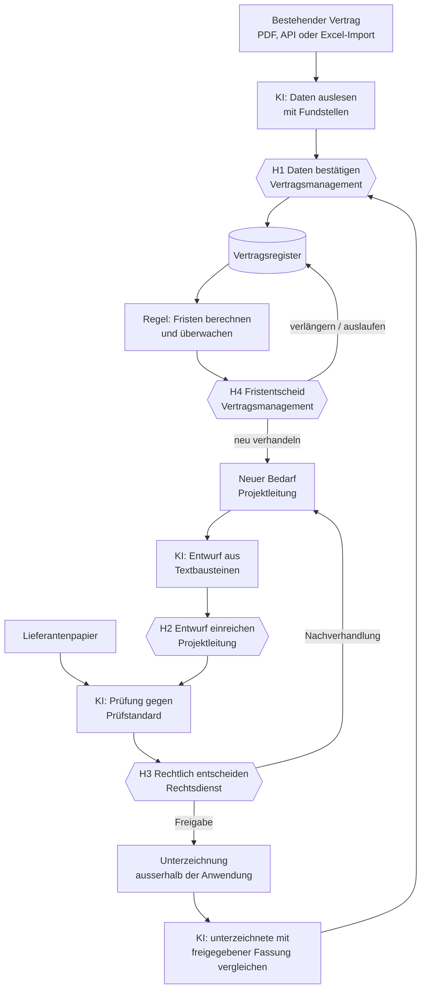
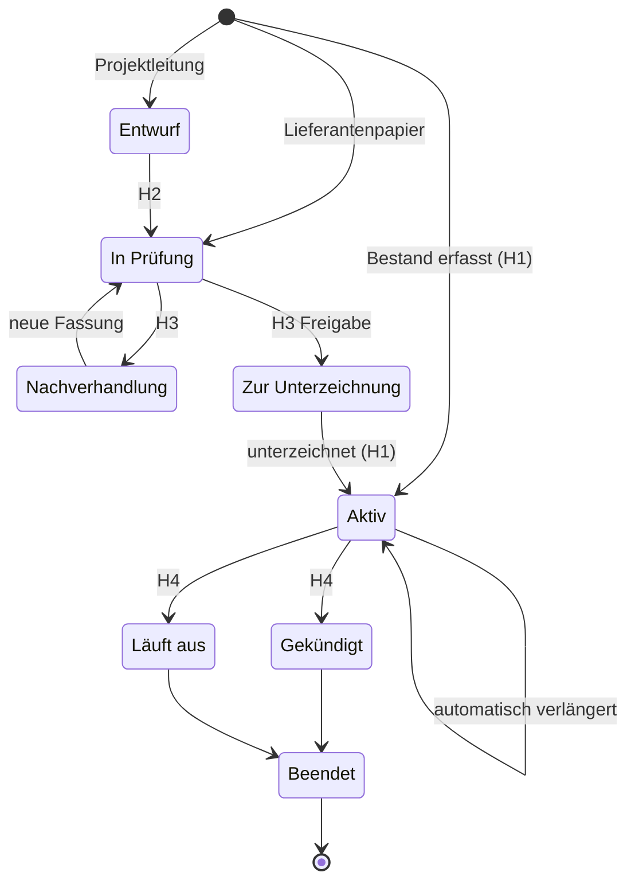
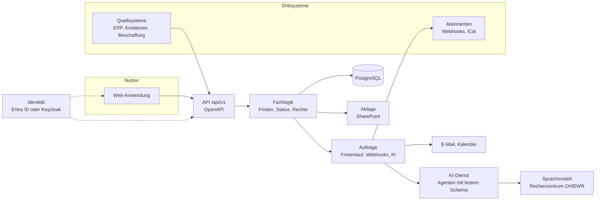

# Vertragsmanagement: Verbesserungen und Zielbild

Stand 12.11.2026. Grundlage ist der Prototyp v0.9.0 in [`prototype/`](../prototype/). Die Quelltexte sind dort entpackt (`prototype/src/`), Verweise in diesem Dokument zeigen auf diese Dateien.

## Kurzfassung

Der Prototyp trifft den Kern: Fristen werden nach festen Regeln überwacht, die KI liest, entwirft und prüft, und Menschen entscheiden. Für eine produktive Anwendung braucht es vor allem fünf Dinge:

1. **Eine Fristenlogik, die weiterrechnet.** Nach einer automatischen Verlängerung bleibt das alte Vertragsende stehen; der nächste Kündigungstermin wird nie berechnet. Kündigungsmodus (Monats-, Jahres-, Laufzeitende) und Zustellfrist fehlen.
2. **Drei klar geschnittene Rollen.** Vertragsmanagement (Einkauf), Projektleitung und Rechtsdienst. Die Rolle «Beschaffung» im Prototyp ist in Wahrheit die Projektleitung. Eine Amtsleitung gibt es nicht.
3. **Vier ausdrückliche Haltepunkte**, an denen der Ablauf auf einen Menschen wartet: Daten bestätigen, Entwurf einreichen, rechtlich entscheiden, Fristentscheid.
4. **Ein geschlossener Lebenszyklus.** Heute endet der Weg bei der rechtlichen Freigabe; die Unterzeichnung und der Abgleich der unterzeichneten mit der freigegebenen Fassung fehlen.
5. **API zuerst.** Alles, was die Oberfläche kann, kann auch ein Drittsystem: Verträge und Dokumente einliefern, Daten und Fristen abholen, über Webhooks benachrichtigt werden.

Dazu kommen Fehler, die vor dem Einsatz behoben werden müssen (Abschnitt 4.6), und eine visuelle Überarbeitung, die die LLV-Marke behält und die Bildschirme um die eigentliche Arbeit herum neu ordnet (Abschnitt 6).

---

## 1. Was der Prototyp gut macht und behalten wird

- **Fundstelle und Konfidenz** bei jedem ausgelesenen Feld (Vertrag erfassen). Das macht die KI überprüfbar und ist die Grundlage für den Haltepunkt H1.
- **Prüfstandard in drei Stufen** je Klausel (akzeptabel, verhandelbar, nicht akzeptabel) plus Musterformulierung ([`src/data.js`](../prototype/src/data.js), `KLAUSELN`). Das ist bereits eine maschinenlesbare Regelbasis.
- **Unveränderte Textbausteine gelten als vorgeprüft.** Der Rechtsdienst prüft nur Abweichungen. Das spart die meiste Prüfzeit und bleibt Grundsatz.
- **Regel «AVV fehlt bei L3/L4-Anwendung»** und die Verknüpfung von Lieferantenklasse A/B/C mit den Anwendungs-Levels L0 bis L4.
- **Erledigen mit Ergebnis** (gekündigt, verlängert, läuft aus) statt blossem Abhaken.
- **Lieferantenbeurteilung** mit KPI, Risiko und Massnahmenplan.
- **Das LLV Design System** (Farben, Open Sans, `llv-*`-Komponenten). Die Marke bleibt.
- **Transparenz** über Ablageort und Datenstandort der KI-Verarbeitung.

---

## 2. Rollen

Drei Rollen für Menschen, dazu technische Zugänge. Die Rollen kommen aus Gruppen im Identitätssystem; eine Person kann mehrere haben und sieht im Umschalter nur ihre eigenen.

| Rolle | Im Prototyp | Aufgabe | Startseite | Haltepunkte | Sieht |
| --- | --- | --- | --- | --- | --- |
| **Vertragsmanagement** (Einkauf) | «Lieferantenmanagement» | Register führen, Verträge erfassen, Fristen überwachen, Lieferanten beurteilen, auswerten | Fristen | H1, H4 | alle Verträge und Lieferanten, schreibend |
| **Projektleitung** | «Beschaffung» | Bedarf anmelden, Entwurf erstellen, Lieferantenpapier einreichen, Nachverhandlung führen | Meine Vorgänge | H2 | eigene Vorgänge; Verträge und Lieferanten der eigenen Organisationseinheit lesend |
| **Rechtsdienst** | «Rechtsdienst» | Verträge prüfen, Prüfstandards und Textbausteine pflegen, Ausnahmen genehmigen | Prüf-Eingang | H3 | alle Verträge lesend, Prüfstandards schreibend |

Ergänzend:

- **Keine Amtsleitung, keine zusätzliche Freigabestufe.** Die Unterzeichnung geschieht ausserhalb der Anwendung. Die Anwendung hält nur fest, dass und wann unterzeichnet wurde, indem die unterzeichnete Fassung hochgeladen wird.
- **Stellvertretung.** Jede Person kann eine Stellvertretung hinterlegen. Erinnerungen gehen bei Abwesenheit oder ausbleibender Reaktion an sie (Abschnitt 4.1).
- **Fachverantwortliche** (heute als Freitext bei der Anwendung hinterlegt) erhalten Erinnerungen zu ihren Verträgen, ohne eigene Rolle.
- **Administration** (Informatik): Gruppen-Zuordnung, API-Zugänge, Webhooks, Vorlaufzeiten. Keine fachlichen Rechte.
- **API-Zugänge** sind Maschinenidentitäten mit eng gefassten Berechtigungen (Abschnitt 8).

---

## 3. Ablauf: feste Regeln, KI-Agenten, Menschen

### 3.1 Drei Ebenen

| Ebene | Was sie tut | Beispiele | Wenn die KI ausfällt |
| --- | --- | --- | --- |
| **Feste Regeln** | Status, Zuständigkeit, nächster Schritt, Fristen | Kündigungstermin berechnen, Prüffrist setzen, AVV-Pflicht prüfen, Erinnerung eskalieren | laufen unverändert weiter |
| **KI-Agenten** | Inhalte lesen, entwerfen, prüfen; liefern Vorschläge in festem Format | Felder auslesen, Klauseln gegen Standard prüfen, Entwurf zusammenstellen | Vorgang bleibt stehen, manuelle Bearbeitung ist immer möglich |
| **Menschen** | beurteilen Vorschläge, geben den nächsten Schritt frei | H1 bis H4 | unverändert |

Ein Agent ändert nie selbst einen Status oder einen Stammdatensatz. Er erzeugt einen Vorschlag; erst ein Mensch an einem Haltepunkt macht daraus Daten.

### 3.2 Die vier Haltepunkte

| | Haltepunkt | Wer | Entscheidet über | Pflicht | Danach |
| --- | --- | --- | --- | --- | --- |
| **H1** | Daten bestätigen | Vertragsmanagement | die ausgelesenen Vertragsdaten | Felder unter 80 % Konfidenz und jede Abweichung zur freigegebenen Fassung einzeln bestätigen | Vertrag ist aktiv, Fristen zählen |
| **H2** | Entwurf einreichen | Projektleitung | ob der Entwurf vollständig ist | jede Abweichung vom Textbaustein begründen | Prüfauftrag an den Rechtsdienst mit Prüffrist |
| **H3** | Rechtlich entscheiden | Rechtsdienst | Freigabe oder Nachverhandlung | rote Punkte nur mit Ausnahme-Begründung freigeben | Freigabe: «Zur Unterzeichnung»; sonst Verhandlungspunkte an die Projektleitung |
| **H4** | Fristentscheid | Vertragsmanagement, mit der Fachverantwortung | kündigen, verlängern, neu verhandeln oder auslaufen lassen | Ergebnis und kurze Begründung | Kündigung: Schreiben aus Vorlage und Termin für den Zustellnachweis; neu verhandeln: neuer Vorgang für die Projektleitung |

### 3.3 Ablauf



### 3.4 Lebenszyklus eines Vertrags



Jeder Übergang ist eine Regel in einer Übergangstabelle mit erlaubter Rolle und Pflichtfeldern. Ungültige Übergänge lehnt die API ab.

### 3.5 Die KI-Agenten

| Agent | Eingabe | Ausgabe (festes Format) | Haltepunkt |
| --- | --- | --- | --- |
| **Erfassung** | PDF eines Vertrags | je Feld: Wert, Zitat, Seite, Konfidenz; Vorschlag für Lieferant und Vertragsart | H1 |
| **Prüfung** | Vertragstext, Prüfstandard in fester Version | je Kriterium: Fundstelle oder «fehlt», Ampel, Begründung, Gegenvorschlag | H3 |
| **Entwurf** | Angaben aus dem Assistenten, Textbausteine | Entwurf; die KI formuliert nur ausgewiesene Freitextfelder (z. B. Gegenstand), Textbausteine bleiben wortgleich | H2 |
| **Abgleich** (neu) | unterzeichnete und freigegebene Fassung | Liste der Abweichungen mit beiden Textstellen | H1 |
| **Massnahmen** | Lieferantenbeurteilung | Vorschlag für den Massnahmenplan | Speichern durch Vertragsmanagement |

Regeln für alle Agenten:

- Ausgabe nur in einem festen, geprüften Schema. Eine Antwort, die das Schema verletzt, gilt als Fehler, nicht als Ergebnis.
- Jede Aussage mit Fundstelle. Ohne Zitat kein Wert.
- Prompt und Prüfstandard sind versioniert; Modell, Prompt-Version und Standard-Version stehen im Protokoll jedes Ergebnisses.
- Ein Testsatz aus rund 30 echten, anonymisierten Verträgen mit bekannten richtigen Antworten. Jede Änderung an Prompt oder Modell läuft zuerst dagegen.
- **Keine Beispieldaten bei Ausfall.** Der Prototyp zeigt dann ein «vorbereitetes Beispielergebnis» ([`src/app.jsx:15`](../prototype/src/app.jsx)). In Produktion heisst ein Ausfall: klare Meldung, Vorgang bleibt offen, manuelle Erfassung steht bereit.
- Personendaten werden vor dem Versand an das Modell auf das Nötige reduziert.

---

## 4. Fachliche Verbesserungen

### 4.1 Fristenlogik

Heute: `Kündigungstermin = Vertragsende − Kündigungsfrist` ([`src/core.jsx:16`](../prototype/src/core.jsx)).

Was fehlt und neu als Regel gilt:

1. **Rollierende Verlängerung.** Nach einem verpassten Kündigungstermin wird das Laufzeitende um die Verlängerungsdauer fortgeschrieben und der nächste Termin berechnet. Heute verschwindet die Meldung nach dem alten Vertragsende, und das Register zeigt ein Ende in der Vergangenheit.
2. **Kündigungsmodus**: auf Monatsende, Quartalsende, Jahresende oder Laufzeitende. Die Rechtsprüfung bemängelt «Kündigung nur auf Jahresende» bereits, das Datenmodell kann es aber nicht abbilden.
3. **Zustellpuffer**: Eine Kündigung muss zugegangen sein. Der Termin, an dem die LLV handeln muss, liegt um einen einstellbaren Puffer (z. B. 5 Arbeitstage) früher und berücksichtigt Wochenenden und liechtensteinische Feiertage.
4. **Kündigungsform** (schriftlich, eingeschrieben, E-Mail) als Feld, damit das Kündigungsschreiben richtig vorbereitet wird.
5. **Keine Kündigungsmeldung bei Verträgen, die ohnehin enden.** Bei `autoVerl: 0` erzeugt der Prototyp zusätzlich zur Meldung «Vertrag läuft aus» eine zweite Meldung «Kündigungsfrist läuft ab» ([`src/core.jsx:31`](../prototype/src/core.jsx)); betroffen sind heute drei Verträge.
6. **Erinnerungsstufen je Klasse**: zum Beispiel A: 180/90/30/7 Tage, B: 90/30/7, C: 60/14. Ohne Reaktion nach 5 Arbeitstagen geht die Erinnerung zusätzlich an die Stellvertretung.
7. **Folge sichtbar machen**: Bei einem verpassten Termin nennt die Meldung, bis wann der Vertrag nun läuft und welches Volumen dadurch gebunden ist.

Beispiel aus den Demodaten, Hosting Bürgerportal: Ende 31.12.2026, Frist 3 Monate, Verlängerung 36 Monate, CHF 185’000 pro Jahr. Der Termin 30.09.2026 ist verpasst. Neue Meldung: *Läuft jetzt bis 31.12.2029, CHF 555’000 zusätzlich gebunden, nächster Kündigungstermin 30.09.2029.* Über alle fünf verpassten Termine der Demodaten sind es CHF 1’166’000.

Die Fristenlogik ist reiner, getesteter Code ohne KI und läuft als täglicher, wiederholbarer Auftrag. Sie liefert auch einen Kalender-Feed (iCal), den Outlook abonniert.

### 4.2 Datenmodell

| Objekt | Neu oder geändert gegenüber dem Prototyp |
| --- | --- |
| **Lieferant** | externe Kennungen (Kreditorennummer, UID/Handelsregister) für die Zuordnung über die API; Kontakte als eigene Liste |
| **Vertrag** | Hierarchie: Einzelvertrag gehört zu Rahmenvertrag, AVV zu Hauptvertrag. Kündigungsmodus, -form, Zustellpuffer. Wert pro Jahr und Gesamtwert, Währung, Indexklausel. Organisationseinheit, Kostenstelle, Vertragsverantwortung, Fachverantwortung, Stellvertretung |
| **Nachtrag** (neu) | Änderungen eines laufenden Vertrags mit Datum und Dokument; die Fristen rechnen mit dem jeweils gültigen Stand |
| **Dokument** | Versionen mit Art (Entwurf, Lieferantenpapier, freigegeben, unterzeichnet, Nachtrag), Prüfsumme, Ablageort |
| **Vorgang** (neu) | der Weg eines Vertrags durch Entwurf, Prüfung und Unterzeichnung, mit Status, Zuständigkeit und Frist |
| **Prüfung** | Ergebnis je Kriterium, Entscheid, Ausnahmen mit Begründung, verwendete Standard-Version |
| **Prüfstandard, Textbaustein** | versioniert, mit Änderungsprotokoll, gepflegt in der Anwendung statt in Word-Dateien |
| **Beurteilung** | KPI und Risiko als datierte Beurteilungen statt eines einzigen aktuellen Stands, damit sich Entwicklungen zeigen |
| **Frist, Aufgabe** | aus Regeln erzeugt; Erledigung mit Ergebnis, Person und Zeitpunkt |
| **Protokoll** | jede Änderung: wer, wann, vorher, nachher, ob ein KI-Vorschlag zugrunde lag |
| **Externe Referenz** | Zuordnung `(System, Kennung) → Objekt` für jedes angebundene System |

### 4.3 Rechtliche Prüfung

- **Fehlende Klauseln erkennen.** Ein Kriterium des Standards, das im Vertrag nicht vorkommt, ist ein eigener Befund («fehlt»), meist rot. Heute werden nur vorhandene Klauseln bewertet.
- **Freigabe mit roten Punkten nur als Ausnahme**, mit Begründung, im Ausnahmen-Register. Der Prototyp kennt solche Fälle bereits als Freitext («Deutsches Recht akzeptiert (Ausnahme)», Nordlicht).
- **Verknüpfte Ansicht**: Ein Klick auf einen Befund springt zur Textstelle links und hebt sie hervor, und umgekehrt.
- **Kommentarfelder einklappen**; sie öffnen sich beim Klick oder bei gelb und rot.
- **Verhandlungsschreiben** aus allen gelben und roten Punkten mit Gegenvorschlägen, als Word-Dokument für die Projektleitung.
- **Prüfstandard in der Anwendung pflegen**, versioniert. Bei einer neuen Version zeigt eine Auswirkungsliste, welche aktiven Verträge davon abweichen.
- **Auswertung**: Welche Abweichungen werden wie oft als Ausnahme akzeptiert? Das ist die Grundlage, um den Standard nachzuführen.

### 4.4 Vertragsentwurf

- **Einstieg nach Absicht** statt nach Vertragsart: *Neuen Vertrag mit LLV-Vorlage erstellen*, *Lieferantenvertrag prüfen lassen*, *Laufenden Vertrag ändern oder verlängern*. Heute wiederholt die Startseite der Rolle den ersten Schritt des Assistenten.
- **Plausibilitätsprüfung**: Der Assistent nimmt «CHF 3 pro Jahr» an. Betragsgrenzen, Pflichtfelder und Grenzwerte aus dem Standard (bereits als Hinweis «Standard: max. 36» vorhanden) werden zu echten Prüfungen.
- **Word-Export mit Änderungsverfolgung**, damit der Lieferant Abweichungen sieht.
- **Sendungsverfolgung** für die Projektleitung: Entwurf, Rechtsdienst, Nachverhandlung, Unterzeichnung, aktiv, jeweils mit Zuständigkeit und Datum.
- **Unterzeichnung als Schritt**: Upload der unterzeichneten Fassung, Abgleich gegen die freigegebene (Agent «Abgleich»), dann H1.

### 4.5 Lieferanten

- **Lieferantenansicht mit Reitern** (Verträge, Anwendungen, Leistung, Risiko, Preise, Protokoll) statt sieben Akkordeons untereinander.
- **Beurteilung im Rhythmus der Klasse** (der Prototyp kennt die Kadenz A/B/C bereits), mit Erinnerung, wenn sie fällig ist.
- **Portfolio-Sichten**: Volumen nach Klasse, Organisationseinheit und Vertragsart; Verlängerungen nach Monat; Anteil der fünf grössten Lieferanten am Volumen; Verträge mit ausländischem Recht; fehlende AVV.
- **Stammdaten aus dem Kreditorenstamm** über die API statt doppelter Pflege.

### 4.6 Fehler und Lücken im Prototyp

| Befund | Stelle | Folge |
| --- | --- | --- |
| Heutiges Datum fest auf 06.11.2026 | [`src/core.jsx:3`](../prototype/src/core.jsx) | alle Fristen falsch, sobald die Zeit weiterläuft |
| Übernahme ins Register mit Platzhaltern: Verlängerung 12 Monate, Recht FL, Gerichtsstand Vaduz, unabhängig vom Vertrag | [`src/lieferantenmanagement.jsx:100`](../prototype/src/lieferantenmanagement.jsx) | falsche Fristen und falsches Recht im Register |
| Kein Fortschreiben nach automatischer Verlängerung | [`src/core.jsx:16`](../prototype/src/core.jsx) | Fristen gehen verloren (4.1) |
| Doppelte Meldung bei Verträgen ohne Verlängerung | [`src/core.jsx:31`](../prototype/src/core.jsx) | Rauschen im Handlungsbedarf |
| Bei KI-Ausfall erscheinen Beispieldaten | [`src/app.jsx:15`](../prototype/src/app.jsx) | erfundene Vertragsdaten möglich |
| Künstliche Wartezeit 3,8 bis 7 Sekunden je KI-Aufruf (`minMs`) | [`src/app.jsx:15`](../prototype/src/app.jsx) | Wartezeit auch, wenn das Ergebnis schon da ist |
| Daten nur im Browser (`localStorage`) | [`src/app.jsx:9`](../prototype/src/app.jsx) | kein gemeinsamer Stand, kein Protokoll |
| Verpasste Kündigungstermine in der Vertragsliste hellgrau, kommende rot | Vertragsliste | das Schlimmste sieht am harmlosesten aus |
| Beträge ohne Plausibilitätsprüfung | Assistent Schritt 3 | «CHF 3 pro Jahr» wird angenommen |
| Datumsfelder folgen der Browsersprache (MM/TT/JJJJ in englischen Browsern) | Erfassen, Assistent | Verwechslung von Tag und Monat |
| PDF-Worker wird aus dem Internet geladen | `prototype/Vertragsmanagement_offline.html` | PDF-Vorschau offline ohne Funktion |

---

## 5. Bedienung je Rolle

### 5.1 Vertragsmanagement: Fristen

Die Startseite ist die Fristenliste, nicht eine Begrüssung über vier Kennzahlen. Gruppiert nach Dringlichkeit, mit dem Entscheid direkt in der Zeile:

```
Fristen                                            Liste | Kalender      Suche (Strg+K)
──────────────────────────────────────────────────────────────────────────────────────
Verpasst, Vertrag hat sich verlängert  5               CHF 1’166’000 zusätzlich gebunden
  Hosting Bürgerportal      Alpina Cloud Services   läuft bis 31.12.2029   Sonderkündigung prüfen
  Rahmenvertrag eTax        Rheinwerk Informatik    läuft bis 31.03.2028   Neu verhandeln
  …
Nächste 30 Tage  6
  Wartung Lohnsoftware      Kronos HR Systeme       absenden bis 23.11.    Kündigen  Verlängern  Auslaufen
  Datenschutzberatung DSFA  Brücke Datenschutz      Review bis 20.11.      Review erfassen
  …
Datenlücken  7                                                                 Alle anzeigen
──────────────────────────────────────────────────────────────────────────────────────
```

- Der Status steht als Wort in der Zeile, nicht nur als farbiger Punkt.
- Datenlücken (kein Dokument, Review-Datum fehlt, AVV fehlt) bilden eine eigene Gruppe statt sich unter die Fristen zu mischen.
- Kalenderansicht pro Monat; Kalender-Feed für Outlook.
- Filter stehen in der Adresse und lassen sich als Link teilen und speichern; jede Liste lässt sich nach Excel exportieren.
- Erfassen per Ziehen einer PDF irgendwo auf die Seite, Massen-Import aus Excel mit Spaltenzuordnung und Prüfung vor dem Speichern.

### 5.2 Projektleitung: Meine Vorgänge

- Startseite mit drei Absichten (4.4) und darunter die eigenen Vorgänge mit Sendungsverfolgung.
- Bei Nachverhandlung: die Punkte des Rechtsdienstes als Checkliste, das Verhandlungsschreiben zum Herunterladen, Upload der neuen Fassung des Lieferanten, die direkt erneut geprüft wird.
- Sicht auf Verträge der eigenen Organisationseinheit, damit die Projektleitung weiss, was es schon gibt (Rahmenvertrag vor Einzelvertrag).

### 5.3 Rechtsdienst: Prüf-Eingang

- Eingang sortiert nach Prüffrist, mit Klasse, Quelle (LLV-Entwurf oder Lieferantenpapier) und Anzahl Abweichungen.
- Bei LLV-Entwürfen standardmässig nur die Abweichungen; der vollständige Text ist einen Klick entfernt.
- Prüfansicht wie in 4.3; Entscheid mit Pflichtbegründung für Ausnahmen.

### 5.4 Für alle

- **Globale Suche** (Strg+K) über Verträge, Lieferanten, Anwendungen und Vorgänge.
- **Vier Zustände** für jeden Bereich, der Daten lädt: Laden (Skelett in der Form des Inhalts), leer (was hierher gehört und die eine Aktion, die es füllt), Fehler (was passiert ist, was zu tun ist), gefüllt.
- **Benachrichtigungen** in der Anwendung und per E-Mail, einstellbar pro Person.
- **KI-Arbeit im Hintergrund**: Statt eines bildschirmfüllenden Ladefensters läuft die Analyse als Auftrag weiter; man kann weiterarbeiten und wird benachrichtigt.

---

## 6. Visuelles Audit

Durchgeführt nach den Regeln des Design-Skills Hallmark (`.claude/skills/hallmark`, Modus *audit*, Bereich *App-Bildschirme*) anhand von Bildschirmfotos aller Ansichten. Das Prüfskript des Skills wurde in dieser Sitzung nicht ausgeführt; die Prüfpunkte wurden von Hand angewendet.

**Zweck**: ein Arbeitswerkzeug für drei Fachrollen; die eine Handlung ist, rechtzeitig über einen Vertrag zu entscheiden.
**Was trägt und bleibt**: das LLV-Blau und Open Sans, die ruhigen Tabellen, die Fundstellen mit Konfidenz, die Ampel der Rechtsprüfung, die Seitenaufteilung Dokument links, Befunde rechts.
**Was nach Vorlage aussieht**: «Guten Tag, Daniel Meier» über vier Kennzahl-Kacheln auf jeder Startseite; das bildschirmfüllende KI-Ladefenster mit Leuchtkugel, Schrittliste und vorbeiziehendem Text; Mittelpunkt-Ketten in jeder Unterzeile; ein Etikett «Textbaustein v2.0» an jeder einzelnen Klausel.
**Was kaputt ist**: Tastaturbedienung, Farbe als einziges Signal, sehr kleine Schrift.

### Befunde

**Muss (Grundanforderung, Ziel WCAG 2.1 AA)**

- 14 klickbare Verweise (`<a onClick>`, ohne `href`) und 5 klickbare Tabellenzeilen sind per Tastatur nicht erreichbar: Hauptnavigation, Brotkrumen, «Erledigen», Rollenmenü ([`src/core.jsx:155`](../prototype/src/core.jsx) und weitere). Dazu fehlt fast überall ein sichtbarer Fokus (eine einzige `:focus-visible`-Regel).
- Dringlichkeit nur über farbige Punkte und Farbe der Datumsangabe; für Menschen mit Farbsehschwäche nicht unterscheidbar.
- Schriftgrössen von 8, 9 und 11 Pixel für Inhalte, 18-mal 11 px allein im App-Stylesheet ([`prototype/styles/app.css`](../prototype/styles/app.css)). Inhalte mindestens 14 px, Fliesstext 16 px.
- Mittelpunkt-Ketten als Metazeilen («Rechtsdienst · 06.11.2026», «10 Bausteine · Standard v2.3»). Besser als getrennte, beschriftete Angaben.
- Etiketten in Grossbuchstaben: «VERTRAGSTEXT» ([`src/rechtspruefung.jsx:113`](../prototype/src/rechtspruefung.jsx)) und die Vertragsart im Entwurfskopf ([`src/vertragsentwurf.jsx:159`](../prototype/src/vertragsentwurf.jsx)). Etiketten in normaler Schreibung, eine Stufe kleiner als der Text.
- Rollenmenü schliesst beim Verlassen mit der Maus (`onMouseLeave`), nicht mit Esc oder Tastatur.

**Sollte (Gewohnheiten, die nach Vorlage aussehen)**

- Begrüssung über vier Kennzahlen als Startseite. Die Startseite gehört dem Objekt, für das das Werkzeug da ist: der Fristenliste (5.1).
- Das KI-Ladefenster blockiert den Bildschirm und erzwingt Wartezeit. Ersetzen durch einen Fortschrittsbalken am Vorgang und Hintergrundauftrag.
- 26 Zeilen mit je einer eigenen «Erledigen»-Schaltfläche und einem Kalender-Symbol. Entscheid-Aktionen in der Zeile, die beim Überfahren und Fokussieren voll erscheinen.
- Drei verschiedene Pillenformen (Filter-Chips, Status-Tags, Segmentschalter) mit ähnlicher Optik. Eine Form je Bedeutung.
- Etikett an jeder Klausel. Nur Abweichungen markieren, unveränderte Bausteine bleiben ohne Etikett.

**Feinschliff**

- Das LLV-Logo ist in der Kopfzeile kaum erkennbar (zu klein, zu wenig Kontrast auf Blau).
- Verpasste Termine in der Vertragsliste hellgrau statt hervorgehoben.
- Datumsfelder in der Browsersprache statt im Format TT.MM.JJJJ.
- Seiten mit wenig Inhalt (Prüfung vor dem Start, Erfassen) lassen zwei Drittel des Bildschirms leer; die nächste Handlung kann dort grösser stehen.
- Nur ein Umbruchpunkt (1100 px); auf Tablets bricht die Prüfansicht nicht sauber um.

### Empfohlene Tiefe

Für die drei Startseiten eine **vollständige Überarbeitung** innerhalb der bestehenden Kopfzeile: Die Inhalte und Funktionen bleiben, die Anordnung ändert sich um die Fristenliste, den Vorgangs-Status und den Prüf-Eingang herum. Für alle übrigen Ansichten genügt **Feinschliff**: Tastatur, Fokus, Schriftgrössen, Statuswörter, Etiketten. Die LLV-Marke (Farben, Schrift, Logo) bleibt in beiden Fällen.

---

## 7. Zielarchitektur



- **Eine API für alles.** Die Web-Anwendung nutzt dieselbe API wie Drittsysteme. Was die Oberfläche kann, kann jedes berechtigte System.
- **Fachlogik als eigenes Paket**, ohne Abhängigkeit von Web oder Datenbank: Fristenberechnung, Statusübergänge, Rechte. Vollständig durch Tests abgedeckt; Fristen sind das, was nie falsch sein darf.
- **Aufträge in der Datenbank** (Warteschlange in PostgreSQL): täglicher Fristenlauf, Webhook-Zustellung mit Wiederholung, KI-Analysen. Kein zusätzlicher Dienst nötig.
- **KI-Dienst hinter einer Schnittstelle**, damit der Anbieter austauschbar bleibt (der Prototyp nennt Azure OpenAI, Schweiz Nord). Antworten werden gegen das Schema geprüft, bevor sie die Fachlogik erreichen.
- **Ablage** über einen Adapter: im Pilot lokal oder in einem Objektspeicher, in Produktion SharePoint über Microsoft Graph.
- **Betrieb** als Container; Datenbank mit täglicher Sicherung und erprobter Wiederherstellung.

---

## 8. API und Integration

### 8.1 Grundsätze

- REST mit OpenAPI 3.1, versioniert unter `/api/v1`. Die Beschreibung wird aus denselben Schemas erzeugt, mit denen die API Eingaben prüft.
- Anmeldung für Systeme über OAuth 2.0 Client Credentials beim Identitätssystem der LLV. Berechtigungen eng gefasst, z. B. `contracts:read`, `contracts:write`, `documents:write`, `reviews:write`, `webhooks:manage`.
- **Idempotenz**: Schreibende Aufrufe nehmen einen `Idempotency-Key`; ein wiederholter Aufruf legt nichts doppelt an.
- **Externe Kennungen**: Jedes Objekt kann über `(System, Kennung)` angesprochen werden, z. B. `PUT /suppliers/by-ref/erp/K-40231`.
- **Gleichzeitige Änderungen** über `ETag` und `If-Match`.
- **Fehler** im Format `application/problem+json` mit deutschem Text für Menschen und festem Code für Maschinen.
- **Delta-Abgleich**: Listen nehmen `updated_since` und liefern einen Cursor.
- Lange Arbeiten (KI) antworten mit `202 Accepted` und einem Auftrag, der abgefragt oder per Webhook gemeldet wird.

### 8.2 Endpunkte (Auszug)

| Zweck | Aufruf |
| --- | --- |
| Lieferant anlegen oder abgleichen | `PUT /suppliers/by-ref/{system}/{id}` |
| Vertrag als strukturierte Daten einliefern | `POST /contracts` |
| Dokument einliefern (Datei oder Verweis) | `POST /documents` → Auftrag für die Erfassung |
| Lieferantenpapier zur Prüfung einreichen | `POST /reviews` |
| Auftrag abfragen | `GET /jobs/{id}` |
| Verträge abholen, gefiltert | `GET /contracts?status=&supplier=&notice_before=&updated_since=` |
| Vertrag mit Fristen, Dokumenten, Prüfungen | `GET /contracts/{id}` |
| Dokument herunterladen | `GET /documents/{id}/content` |
| Fristen eines Zeitraums | `GET /deadlines?from=&to=` |
| Kalender-Feed | `GET /deadlines.ics?token=` |
| Export | `GET /exports/contracts.xlsx`, `.csv` |
| Protokoll | `GET /audit-events?since=` |
| Webhooks verwalten | `POST /webhooks`, `GET /webhooks/{id}/deliveries` |

### 8.3 Webhooks

Ereignisse: `contract.created`, `contract.updated`, `contract.activated`, `contract.renewed`, `contract.terminated`, `deadline.upcoming`, `deadline.missed`, `review.completed`, `draft.submitted`, `document.extracted`.

Jede Zustellung ist mit HMAC signiert, trägt eine eindeutige Kennung und wird bei Fehlern mit wachsendem Abstand wiederholt. Ein Zustellprotokoll zeigt jeden Versuch.

```json
{
  "id": "evt_01JD6…",
  "type": "deadline.upcoming",
  "occurred_at": "2026-11-12T06:00:00+01:00",
  "data": {
    "contract_id": "V-2270",
    "external_refs": [{ "system": "erp", "id": "K-40231-7" }],
    "kind": "notice",
    "act_by": "2026-11-23",
    "notice_effective": "2026-11-28",
    "consequence": "verlängert sich um 12 Monate bis 28.02.2028",
    "annual_value": { "amount": 58000, "currency": "CHF" }
  }
}
```

### 8.4 Anbindungen

- **Quellsystem** (ERP, Finanzbuchhaltung oder Beschaffungsplattform; siehe offene Entscheidungen): Kreditorenstamm hinein, aktive Verträge und Verpflichtungen hinaus.
- **SharePoint**: Ablage der Dokumente am heutigen Ort; die Anwendung führt den Pfad.
- **Outlook**: Termine und E-Mails über Microsoft Graph oder Kalender-Feed.
- **Excel**: Erst-Import des heutigen Bestands mit Spaltenzuordnung, Prüfung und Probelauf.

---

## 9. Technologie und Bibliotheken

**Empfehlung für den Pilot**: durchgehend TypeScript.

- Web: React mit Vite, die LLV-Farben und -Schrift als CSS-Variablen aus [`prototype/styles/llv-tokens.css`](../prototype/styles/llv-tokens.css) übernommen.
- API: Node.js mit Fastify, Zod-Schemas für Prüfung und OpenAPI-Beschreibung, Drizzle als Datenbankzugriff, PostgreSQL, pg-boss für Aufträge.
- Gemeinsames Paket für Fachlogik und Schemas, das Web und API nutzen.

**Zu beachten**: Die Vorlagen im LLV Design System sind Angular (`@llv/ux`, angelehnt an PrimeNG) mit Keycloak-Anmeldung. Soll die Anwendung später von der Informatik der LLV betrieben werden, ist Angular mit `@llv/ux` für die Oberfläche die bessere Wahl. API und Fachlogik bleiben davon unberührt. Das ist Entscheidung 1 unten.

**Bibliotheken für die Oberfläche** (React), ausgewählt mit dem Skill *pick-ui-library* (`.claude/skills/pick-ui-library`):

| Aufgabe | Bibliothek | Ersetzt im Prototyp |
| --- | --- | --- |
| Dialoge, Menüs, Auswahllisten, Popover, Reiter mit Tastaturbedienung | base-ui | eigener `Dialog`, Rollenmenü mit `onMouseLeave` |
| Hinweise und Bestätigungen | Sonner | eigene `Toasts` |
| Globale Suche (Strg+K) | cmdk | neu |
| Preis- und Volumenentwicklung | recharts | handgezeichnete SVG-Grafik |
| Klauseln im Entwurf umsortieren | dnd kit (Pfeiltasten bleiben für Tastatur) | Pfeil-Schaltflächen |
| Zustand der Oberfläche | zustand | ein grosser Kontext plus `localStorage` |
| Bedingte Klassennamen | clsx | Zeichenketten-Verkettung |
| Lange Listen | Virtuoso, erst ab rund 1’000 Zeilen | nicht nötig zum Start |

Animationen bleiben einfache CSS-Übergänge; eine Animationsbibliothek ist nicht nötig. Nicht in der Liste des Skills und daher eigene Empfehlung: TanStack Table (Tabellen mit Sortierung und Filtern), TanStack Query (Daten vom Server), React Hook Form mit Zod (Formulare mit denselben Schemas wie die API), react-day-picker mit Gebietsschema `de-CH` (Datumsauswahl), pdf.js (bereits im Prototyp), docx (Word-Export auf dem Server).

---

## 10. Sicherheit, Datenschutz, Nachvollziehbarkeit

- **Protokoll**: jede Bearbeitung und jede Entscheidung, nur anfügbar, nicht änderbar. Bei KI-Vorschlägen zusätzlich Modell, Prompt-Version, Standard-Version und wer den Vorschlag übernommen hat.
- **Rechte** je Rolle und Organisationseinheit, auf Datenbankebene durchgesetzt, nicht nur in der Oberfläche.
- **Datenschutz** nach DSG und DSGVO (EWR); Amtsgeheimnis. Der KI-Anbieter verarbeitet in der Schweiz oder im EWR, speichert nichts und trainiert nicht mit LLV-Daten. Vertragsinhalte verlassen die Infrastruktur nur zur Analyse.
- **Hochgeladene Dateien** werden auf Schadsoftware geprüft; nur PDF und DOCX.
- **Aufbewahrung**: Fristen für beendete Verträge und Protokolle nach den Vorgaben der LLV; Löschung nachweisbar.
- **Barrierefreiheit**: WCAG 2.1 AA als Abnahmekriterium jeder Etappe.

---

## 11. Vorgehen in Etappen

| Etappe | Inhalt | Abgenommen, wenn |
| --- | --- | --- |
| **1 Register und Fristen** | Datenmodell, API mit Anmeldung, Lieferanten und Verträge, Excel-Import, Erfassung mit KI und H1, Fristenlogik mit Erinnerungen und Kalender-Feed, H4, Protokoll, drei Rollen | der heutige Bestand ist importiert und jede Frist stimmt mit einer manuellen Nachrechnung überein |
| **2 Rechtliche Prüfung** | Prüfstandards in der Anwendung, Prüfung von Lieferantenpapier mit fehlenden Klauseln, H3 mit Ausnahmen, Verhandlungsschreiben | der Rechtsdienst prüft zwei echte Lieferantenverträge vollständig in der Anwendung |
| **3 Entwurf und Unterzeichnung** | Assistent nach Absicht, Textbausteine, H2, Word-Export, Unterzeichnung mit Abgleich, Übernahme ins Register | ein Vertrag läuft vom Bedarf bis «Aktiv» ohne Medienbruch |
| **4 Anbindungen und Auswertung** | Webhooks, Quellsystem, SharePoint, Outlook, Portfolio-Sichten | ein Drittsystem erhält Fristen und Vertragsänderungen ohne manuellen Export |

Die visuelle Überarbeitung (Abschnitt 6) läuft in Etappe 1 mit, beginnend bei der Fristenliste.

---

## 12. Offene Entscheidungen

1. **Oberfläche**: React (schneller Pilot, Bibliotheken wie in Abschnitt 9) oder Angular mit `@llv/ux` (Standard der LLV-Informatik)? Empfehlung: React für den Pilot, sofern der spätere Betrieb nicht schon feststeht.
2. **Rechtsrahmen**: Der Prototyp ist auf die Liechtensteinische Landesverwaltung ausgelegt (CHF, liechtensteinisches Recht, Gerichtsstand Vaduz, Landesindex der Konsumentenpreise). Bleibt das so, oder ist eine Organisation in Deutschland gemeint (EUR, deutsches Recht, andere Prüfstandards)?
3. **Quellsystem**: Welche Systeme liefern Daten ein und welche sollen Daten erhalten (ERP oder Finanzbuchhaltung, Beschaffungsplattform, SharePoint, E-Signatur)?
4. **Anmeldung**: Entra ID (wie im Prototyp) oder Keycloak (wie in den LLV-Vorlagen)?
5. **KI-Anbieter und Betrieb**: Azure OpenAI wie im Prototyp oder ein anderer Anbieter mit Verarbeitung in der Schweiz oder im EWR; Betrieb auf eigener Infrastruktur oder in der Cloud?
6. **Sichtbarkeit für die Projektleitung**: nur eigene Vorgänge, oder alle Verträge der eigenen Organisationseinheit lesend (Vorschlag in Abschnitt 2)?
